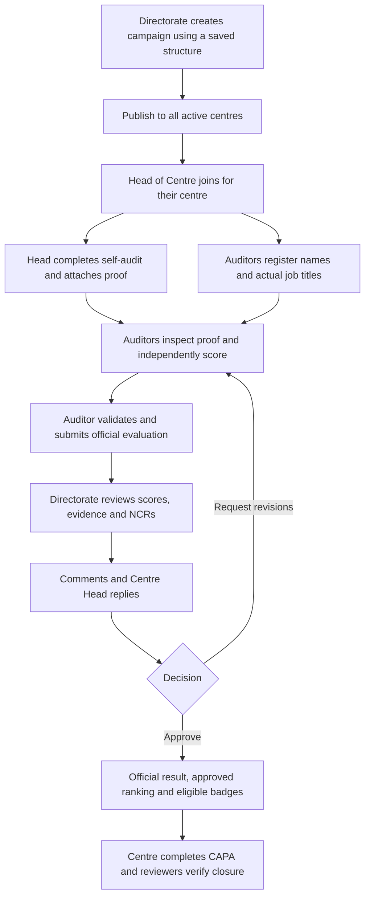

# Kafaa role UI implementation plans

Prepared: 13 November 2026; updated 14 November 2026, Asia/Muscat.
Plans 1–4 are implemented. Remaining manual platform checks are recorded in the
individual plans. Implementation and
verification are recorded in [PROJECT_REVIEW.md](PROJECT_REVIEW.md).

## Read the plans

| Plan | Intended experience |
| --- | --- |
| [1. Admin / owner and tester](plans/01_ADMIN_OWNER_TESTER.md) | Configure the application, administer access, and interactively test each role without signing out |
| [2. Directorate](plans/02_DIRECTORATE.md) | Manage centres, publish campaigns, monitor achievement, discuss revisions and approve official results |
| [3. Head of Centre](plans/03_CENTER_HEAD.md) | Join campaigns, assess readiness, upload proof, compare self and official scores, and respond to feedback |
| [4. Auditors / reviewers](plans/04_AUDITORS_REVIEWERS.md) | Record the evaluation team and actual jobs, inspect proof, score criteria and submit the official evaluation |
| [Shared technical contract](plans/00_SHARED_TECHNICAL_CONTRACT.md) | Permission predicates, database integrity, offline operation, migration order and cross-role acceptance tests |

The shared contract is part of every role plan. SQL blocks describe target
additions, not runnable deployment migrations; triggers, policies, grants and
RPC bodies must be implemented and verified together before deployment.

## Product workflow

The owner can run the same journey in an isolated tester workspace using mock
centres, scores and proof. Production access always uses the actual account's
database permissions.

## Findings from the current workspace

Reviewed the working tree, including existing uncommitted application changes.
This plan does not revert or replace them. The attachment is a requirements
source; where it differs from the code, the following is the planning baseline.

| Area | Current source / recorded evidence | Planning consequence |
| --- | --- | --- |
| Identity | `AppRole` has `superAdmin`, `directorate`, `auditor`, `centerManager`, `viewer`; permissions resolve through `sessionProvider` | Keep the existing wire roles; call `centerManager` “Head of Centre” in the new UI |
| Shared assessments | Strict shared-only migration requires `audits.participation_id`; sessions and join/review RPCs already exist | Extend this lifecycle; no standalone official or self-audit route |
| Scoring | Baseline seed defaults are Met 3, Partially Met 2, Not Met 1; criteria can override the scale | Read the saved structure's actual options; do not hardcode the attachment's 3 / 1–2 / 0 |
| Checklist | Audit Structure v 1.00 has 79 criteria / 237 maximum points; source checklist has six tables, while the seed has five scoring domains | Generate domain navigation/charts from the selected blueprint, rather than assuming six domains or 79 items for every future version |
| N/A | Per-criterion `allows_not_applicable`; disabled by default in the baseline | Offer N/A only where the selected saved structure permits it |
| Findings | Both partial and unmet answers can raise NCRs after official submission; suppression requires a reason | Show pending finding previews while scoring; create official NCRs on submission; self-audits create no official NCRs |
| Centre registry | Directorate registry/revision guards are deployed; Heads retain own permitted contact/count edits | Reuse those guards and existing geographic fields |
| Team | `audit_team_members` exists; names/role labels are nullable; no dedicated Flutter workflow | Add actual-job snapshots, team responsibility, validation, and a team sheet |
| Offline | `sqflite` cache/outbox, schema version 3; Riverpod 2; GoRouter 14 | Extend these implementations; introducing Drift or a state-management migration is unnecessary |
| Evidence | Official uploads and separate self-proof persist native files by project/user and web bytes in the outbox | Self downloads/snapshots are implemented; official proof-review provenance remains in Plan 4 |
| Review dialogue | Participation discussion and review decision history are deployed | Heads reuse the discussion and durable CAPA replies; no second message system |
| Navigation | Adaptive role-based destinations exist; router currently handles authentication, with screen-level checks | Add explicit scoped route guards, including direct URLs and preview changes |

Relevant files: `lib/features/auth/session.dart`, `lib/shell/navigation.dart`,
`lib/core/routing/app_router.dart`, `lib/features/audit/audit_controller.dart`,
`lib/core/offline/{local_store,sync_service}.dart`, and the repositories under
`kafaa_app/lib/data/repositories/`. Paths beginning `lib/` in these plans are
relative to `kafaa_app/`.

The original planning task used the hosted facts recorded in project memory.
The Plan 1 implementation subsequently reverified the dedicated `kafaa_db`
connection and deployed access guards. Its evidence is recorded in the project
review. Before later database investigations, verify the exact configured
endpoint and `get_project_url` through the dedicated connection. See the
[connection instructions](SUPABASE_CONNECTION.md).

## Access and responsibility

“Own centre” below means a current, explicit, centre-scoped grant. A typed URL,
team roster entry or chosen preview centre never grants database access.

| Capability | Admin in normal mode | Directorate | Head of Centre | Auditor |
| --- | --- | --- | --- | --- |
| Manage users / role grants | Yes | No | No | No |
| Save audit structure versions | Yes | Select saved versions | No | No |
| Add/edit/deactivate centres | Yes | Yes | Own allowed contact/count fields | No |
| Create/publish/close a campaign | Yes | Yes | No | No |
| Join a campaign | Any eligible centre | Any eligible centre | Own centre | Centre covered by auditor grant |
| Edit self-audit and internal proof | Explicit owner action | Read | Own centre | Read within auditor scope |
| Edit official scores and official team | Yes | Yes, existing permission | No | Within auditor scope |
| Send audit discussion messages | Yes | Any centre | Own centre | Within auditor scope |
| Request revisions / approve | Yes | Yes | No | No |
| View national progress / comparison | Yes | Yes | Own participation/result | Authorized scope only |
| Respond to CAPA | Yes | Yes | Own centre | Within auditor scope |
| Verify/close NCR | Yes | Yes | No | Within auditor scope |
| Enter “View as” tester mode | Yes | No | No | No |

The `viewer` role remains supported by current read permissions and navigation.
Do not accidentally give it any new write action. Multi-role accounts choose a
workspace; permissions remain scoped unions of real grants. UI context can
narrow that union but cannot expand it.

## Navigation and screen map

| Workspace | Phone destinations (maximum five) | Key full-screen routes |
| --- | --- | --- |
| Admin | Home, Centres, Assessments, Actions, More | `/more/admin`, `/more/admin/users`, `/more/admin/tester`, saved structure editor |
| Directorate | Overview, Centres, Assessments, Actions, More | `/directorate/centers`, `/assessments/new`, `/assessments/:sessionId/progress`, `/audits/:auditId/review` |
| Head of Centre | My Centre, Assessments, Actions, Staff, More | `/assessments/:sessionId/self-audit`, `/assessments/:sessionId/gap`, `/audits/:auditId/dialogue` |
| Auditor | Work, Assessments, Actions, More | `/audits/:auditId/team`, `/audits/:auditId/run`, `/audits/:auditId/submit`, `/audits/:auditId/dialogue` |

New routes are proposed. Keep `/audits/new` as a redirect to the existing shared
campaign builder at `/assessments/new`; never resurrect standalone creation.
Static paths such as `new` must resolve before parameter paths. Keep the
existing simplified `/centres` page free of the removed search box/comparison
banner. Search belongs in the distinct directorate registry management screen;
national comparison belongs in the campaign progress screen.

When a user manages several centres, show a centre picker before opening an
own-centre route. Use `?centerId=` only as a requested context, and validate it
against grants and participation. Never select an arbitrary centre when the
scope is ambiguous. Tablet/desktop use the same destinations in a rail and
master/detail layouts.

## Delivery order and reviewable milestones

| Milestone | Work and dependency | Acceptance evidence |
| --- | --- | --- |
| M0 — baseline | Reverify scoped hosted schema/history, current role grants and saved scoring; preserve dirty working tree and local queues | Recorded schema diff and scoring fixtures; no guessed migrations |
| M1 — permissions and tester core | Shared workspace/route guards, repository boundaries, sandbox preview | Each role navigation works; preview produces zero live mutations |
| M2 — directorate registry/campaigns | Extend existing registry policy/guard; reuse publish/join lifecycle; explicit progress buckets | Directorate can create a mock campaign and see one eligible row per active centre |
| M3 — centre self-audit | Separate versioned self-audit data, scored responses, proof storage and offline outbox | Head can resume saved work offline; self-scoring leaves official totals/NCRs unchanged |
| M4 — auditors | Team identity, criterion proof review, submission preflight and sign-off | Official submission records team/jobs and reviewed proof; concurrent/offline errors preserve drafts |
| M5 — dialogue and approval | Shared conversation, decision history, revision workflow and notifications | Head reply reaches the review hub; approval locks official work and updates authorized results |
| M6 — gaps and achievement | Pinned self baseline versus latest approved official version; campaign-scoped analytics | Comparison never mixes periods or replaces missing results with old scores |
| M7 — owner toolbox and release QA | Scenario reset/offline toggles, outbox inspector, full role/device checks | Bilingual phone/tablet evidence and all automated checks pass |

Each milestone is additive and feature-gated. M1 includes a minimal switcher;
M7 completes its scenario library and diagnostics. Dialogue can be developed
after M2, but release it with M5's transactional review behavior. Do not enable
new screens on a server missing their schema/RPCs. Centre Head delivery is
recorded in [Plan 3](plans/03_CENTER_HEAD.md#implementation-record--14-november-2026).

## Product decisions and defaults

These are planning decisions, not requests to stop documentation work.

1. **Self-audit is now explicitly requested.** Implement it as a separate
   readiness assessment with the same pinned checklist, never as official
   auditor scores. This supersedes the earlier plan's unresolved self-scoring
   question.
2. **Scoring policy still needs an explicit clinical choice if it is to change.**
   Preserve saved v 1.00, thresholds, grading and N/A rules. If Not Met = 0 or a
   flexible partial score is intended, authorize and publish a new structure
   version. Never rewrite historical scores or introduce a free points slider.
3. **Keep NCR creation on official submission.** While scoring, show a finding
   preview. Immediate draft NCR creation would change the decision documented
   in [ASSUMPTIONS.md](ASSUMPTIONS.md).
4. **Readiness baseline:** freeze the latest submitted self-audit at the first
   official submission. Gap analysis uses that snapshot. Later approved-result
   corrections retain that baseline. Missing self-audit does not prevent the
   official evaluation.
5. **Revision ownership:** Directorate requests revisions from the official
   evaluation team; the Head replies and supplies clarification/proof. The Head
   cannot change official answers. Existing `rejected` means “Revisions
   requested” in this workflow, not final campaign cancellation.
6. **Clinical jobs:** required actual job title and full name for new team
   members; team responsibility is a separate field. A recorded title is
   self-declared professional information, not license verification.
7. **Auditor scope:** retain existing roaming/centre-scoped grants. A roster
   member is attribution only. Restricting edits to explicitly assigned teams
   would be a separate access-policy decision.
8. **Approved badge:** show the result approval indicator immediately after
   confirmed approval. Public achievement badges retain their existing separate
   directorate approval/publication rules; no automatic public release.

## Cross-role release acceptance

Use synthetic Kafaa fixtures with two centres, different roles, a published
campaign and the selected saved structure. The Head joins, scores internally
and uploads proof. An auditor supplies the team roster, reviews that proof,
records a different score and submits. Directorate requests a revision; the
Head replies; the auditor revises and resubmits. Directorate approves. Verify
the immutable self baseline, final gap, official ranking, NCR provenance and
the full conversation. Repeat the critical steps with lost network, lost ACK,
app restart and Arabic RTL. Repeat unauthorized actions through the API, not
only by hiding buttons.

Required implementation checks: `flutter analyze`, all existing `flutter test`
tests (176 at planning baseline) plus the additions in each plan, SQL role and
Storage policy tests, and a configured dev launch using `./scripts/run-kafaa`.
Record actual results in `docs/PROJECT_REVIEW.md`; future tests in these plans
are requirements, not completed verification.

Current documentation-task verification: `flutter analyze` passed and all 176
existing Flutter tests passed. These baseline checks do not validate the
unimplemented features or proposed SQL in this pack.

Auditor delivery is recorded in [Plan 4](plans/04_AUDITORS_REVIEWERS.md#implementation-record--14-november-2026).
The final automated baseline is 275 passing Flutter tests, clean analysis, nine
SQL suites, concurrency checks and scoped hosted verification. Manual hardware,
iOS and browser-specific proof checks remain as documented; these are separate
from the completed implementation.
