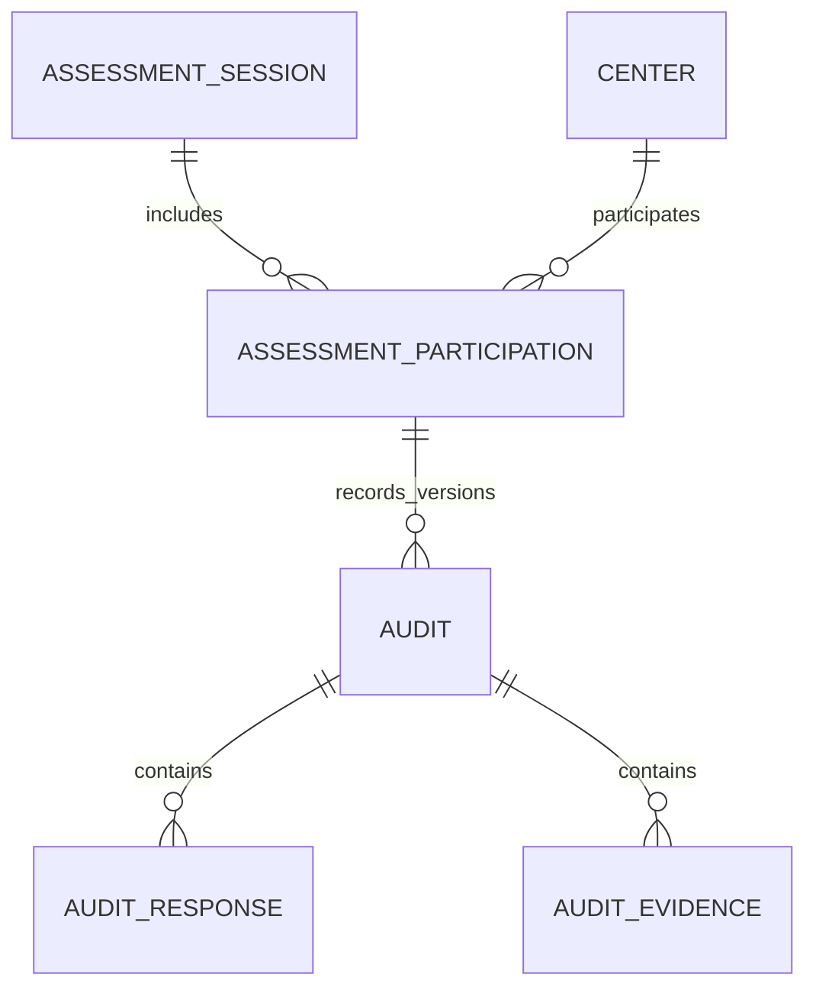

# Shared assessments and centre participation

Prepared on 12 November 2026, Asia/Muscat. Status is proposed design, ready for implementation planning.

## 1. Intended workflow

Directorate users create one assessment for all active Kafaa centres. Each centre joins that assessment and receives its own checklist, progress, evidence, score and review outcome.

For example, publishing **Audit Structure v 1.01 · H2 2026** makes the assessment available to Bousher, Seeb, Al Amerat and Quriyat. Joining from Seeb opens Seeb's checklist. Directorate users can follow all four centres from the shared assessment.

The app can continue using the word **Assessment**. `assessment_sessions` is the proposed database name for the shared record. The existing `audits` table supplies each centre's assessment and its correction history.

### Recommended product defaults

- Directorate and Super Admin create and publish shared assessments.
- Centre managers join on behalf of centres they manage. Scoped auditors can join for centres they may audit. Directorate can join on a centre's behalf.
- Auditors and directorate perform scoring under their existing centre scopes. Directorate approves results.
- First-time joining receives online server confirmation. Once joined, downloaded checklists and queued work support offline assessment.
- Each assessment covers one selected period. Frequency describes that period. Directorate publishes the next period as another assessment.

These are proposed product defaults. The user's confirmed requirement is creation for all centres with centre participation. Self-scoring by centre managers would require a further role decision.

## 2. Verified starting point

Read-only inspection used the dedicated `kafaa_db` connection. Both `.codex/config.toml` and `get_project_url` identified `onzmwoajiyennqtjcjez`. SQL executed as `supabase_read_only_user`.

| Area | Verified state |
| --- | --- |
| Existing records | Four active centres and nine audits, comprising eight approved audits and one draft |
| Audit identity | `audits.center_id` and `audits.template_id` are required |
| Related work | Responses, evidence, samples, team members, NCRs and badges reference the existing audit ID |
| Revision support | `audits.version` and `audits.parent_audit_id` already exist |
| Structure versions | Saved structure versions are locked and audits retain their chosen template |
| Shared assessments | The hosted public schema has no session or centre-participation table |
| Period support | Hosted `audits` and `v_audit_summary` lack `period_frequency` and `period_key`. The period enum is also absent |
| Migration tracking | Hosted migration history returns an empty list despite deployed objects |
| Permissions | Auditors/directorate create audits. Managers currently lack audit insertion permission and cannot read audit drafts through `audits_read` |
| Local workflow | `NewAuditScreen` selects one centre and calls `AuditRepository.createDraft`, then opens that centre's runner |
| Offline work | Project/user-scoped caches and an outbox hold audit creation, responses, evidence, samples and updates |

The eight historical approved audits use individual rolling date ranges. The current draft covers 1 July–31 December 2026. Grouping every record with the same cycle label would combine different review windows.

Local migration `0012_assessment_periods.sql` includes updates that invoke date normalization. Its introductory preservation claim conflicts with its executable backfill. The new migration must explicitly preserve historical date ranges.

The review included hosted schema, RLS, trigger definitions, migration history, security advisors and a targeted PostgreSQL error-log query. Compare implementation-time advisors against the recorded baseline.

## 3. Changes to the app

### Create assessment

Replace the screenshot's form with the following shared fields.

| Field | Behaviour |
| --- | --- |
| Audit Structure | Select a saved version and show its item count and maximum points |
| Assessment name | Default from structure and period, with optional editing |
| Cycle | Keep the current cycle label |
| Frequency | Monthly, quarterly, every six months or yearly |
| Period covered | Select the complete period using the existing picker |
| Due date | Optional submission deadline, displayed in Muscat time |

Remove the centre selector from this form. Move evaluation date, evaluator, registered-patient count and dialysis-bed count to the centre assessment's general information. Record the shared assessment's creator separately through `created_by`.

Provide **Save draft** and **Publish assessment**. Publication opens the assessment to all active centres. After publication, show the shared assessment overview.

### Assessment list and overview

- Show one card per shared assessment, with structure version, cycle, period and availability.
- Directorate sees eligible, joined, submitted and approved centre counts, plus each centre's current progress.
- A centre-scoped user sees **Join assessment**, **Continue assessment**, **Awaiting review** or **View result**, according to their role and centre status.
- A manager with one centre joins directly for that centre. Users with multiple authorized centres choose a centre during joining.
- Assessments opens the shared session list directly. Centre scoring records are reached through shared participation.
- On a centre's detail screen, show available shared assessments and its joined records. Update Home shortcuts and empty-state actions to use the same workflow.

### Joining and centre general information

Joining creates the centre's draft and opens its assessment details. Prefill patient and bed counts from the centre record, allow authorized correction, and store the values as that assessment's snapshot.

The joining user is recorded as `joined_by`. Assign the evaluator through the scoring workflow. An auditor joining for their own work may be offered as the evaluator. A manager joining a centre should receive a clear joined confirmation and the available centre actions.

Evaluation date can remain empty until assessment work begins. Require it before submission of a new session-linked audit. This needs a nullable database column for unstarted audits and corresponding date ordering in the app.

Centre managers gain read access to their own session-linked draft and progress. Their score, evidence and sample write permissions follow the role table below. Every centre assessment requires a valid shared participation.

All new labels, status messages, forms and errors need English/Arabic translations and RTL verification.

## 4. Database changes

### Add `assessment_sessions`

| Columns | Purpose |
| --- | --- |
| `id`, `client_uuid` | Stable identity and retry protection for creation |
| `title_en`, `title_ar` | Shared assessment display names, with localized fallback |
| `template_id` | The saved Audit Structure selected for the assessment |
| `cycle_label` | Display cycle |
| `period_frequency`, `period_start`, `period_end`, `period_key` | Authoritative review period |
| `status` | `draft`, `open` or `closed` |
| `due_at` | Optional deadline stored as a timestamp with time zone |
| `published_at`, `closed_at` | Lifecycle timestamps |
| `created_by`, `created_at`, `updated_at` | Authorship and audit trail |

Use a foreign key with restricted deletion for the template. Validate supported frequency, exact calendar boundaries and start/end ordering on the server. Derive `period_key` on the server.

Recommend a unique constraint on `(template_id, period_frequency, period_start, period_end)` to prevent accidental duplicate official assessments. Treat cycle labels and titles as display values. A deliberate repeat round would need a product decision about its separate identity.

Once published, pin the template, cycle and period. Allow audited deadline extensions and reopening by directorate. Protect published records and their participation history from cascading deletion.

### Add `assessment_participations`

| Columns | Purpose |
| --- | --- |
| `id` | Participation identity |
| `session_id` | Shared assessment, with restricted deletion |
| `center_id` | Participating centre, with restricted deletion |
| `eligible_at` | When the centre became eligible |
| `joined_at`, `joined_by` | Server-confirmed join and actor, initially empty |

Enforce `UNIQUE (session_id, center_id)`. Publication inserts an eligibility row for every active centre in the same transaction. An eligibility row appears as **Not joined** until `joined_at` is populated. The centre's checklist is created when it joins.

Centres activated while an assessment is open automatically receive eligibility. Use one transactional reconciliation routine for publication and centre activation, with a common transaction-level lock, to cover concurrent activation/publication. Retry-safe insertion uses the unique session/centre key. A centre deactivated after publication retains its participation history and counts. Deactivation prevents new joining and scoring, while directorate can complete review. Activation after an assessment has closed applies to future open assessments.

Derive progress from the associated audits. Store joining as a fact and use the existing audit workflow for scoring/review status.

### Extend `audits`

- Add nullable `participation_id` referencing `assessment_participations` with restricted deletion.
- Keep existing audit IDs and their dependent records, including response uniqueness on `(audit_id, criterion_id)`.
- Add `UNIQUE (participation_id, version)` for session-linked audits. Permit one root audit per participation through a partial unique index where `parent_audit_id IS NULL`.
- Validate that every linked audit's centre, template, cycle and period match its participation/session. Derive these values from the session during creation.
- Protect participation and centre identity after creation. Validate that a correction's parent belongs to the same participation and that its version advances correctly.
- Serialize correction creation on the participation row. The working assessment is its highest version. The official result is its highest approved version.
- Make `evaluation_date` nullable for unstarted records, with submission validation for linked audits. Carry forward all existing evaluation dates.
- Initialize score caches from the selected structure when joining so zero-answer drafts show the correct denominator immediately.

Add indexes for participation by centre, session progress lookups, audits by participation/version and session listing by period/status. Reuse existing centre/audit evidence paths.

### Reconcile period support

Create a reviewed additive migration against the inspected hosted state. Introduce the needed period type/columns and preserve existing audit dates, status, scores and approval provenance during backfill.

Assign calendar frequency/key only where the stored dates exactly match that calendar period. Represent rolling historical ranges as `custom`, with an unambiguous range key and date-range label. Apply calendar-period validation to new sessions. Have linked audits inherit the exact session values. Legacy audit updates must preserve their stored range.

Extend `v_audit_summary` additively and retain invoker rights. Review the local combined installer and migration 0012 so fresh installation and hosted upgrade converge on the same period behaviour.

## 5. Server operations and permissions

Use transactional database RPCs for publication, joining, closing/reopening and correction creation. Prefer invoker-rights functions with supporting RLS, protected-column grants/guards, fixed search paths and authenticated execution grants. Check current role grants from the existing authorization tables. Supabase documents both RLS requirements and function execution privileges. [Row Level Security](https://supabase.com/docs/guides/database/postgres/row-level-security), [Database functions](https://supabase.com/docs/guides/database/functions)

| Action | Directorate / Super Admin | Auditor | Centre manager | Viewer |
| --- | --- | --- | --- | --- |
| Create/publish/close/reopen shared assessment | Allowed | — | — | — |
| See published availability | Allowed | Authorized centres | Managed centres | Existing readable scope |
| Join a centre | Allowed | Authorized audit scope | Managed centres | — |
| Read joined centre draft | Allowed | Authorized audit scope | Own joined centre | Existing readable scope |
| Edit centre header | Allowed | Authorized audit scope | Own draft patient/bed counts | — |
| Score, attach audit evidence, draw samples | Allowed | Authorized audit scope | Requires auditor grant | — |
| Submit | Allowed | Authorized audit scope | Requires auditor grant | — |
| Review/approve/reject | Allowed | — | — | — |
| See cross-centre progress/comparisons | Allowed | Existing authorized scope | Own centre | Existing readable scope |

### `publish_assessment`

Acquire the common eligibility lock, then the session's lifecycle lock. Verify directorate permission, lock the draft session row, validate its saved structure and complete period, add all active-centre eligibility rows and mark it open. Record publication through `activity_log`. A repeated successful publication returns the existing open assessment.

### `join_assessment`

1. Check the caller's current permission for the requested centre. Acquire the session's lifecycle advisory lock, read its state, then lock the caller-authorized participation row.
2. If the centre has already joined, return its current working audit ID. A retry after a lost acknowledgement resolves to that same identity, including after closure.
3. For a new join, verify open state, deadline, active centre and eligibility.
4. Create audit version 1 with server-derived identity fields, a server-generated canonical audit ID, protected scoring caches and the centre's general-information snapshot.
5. Set `joined_at` and `joined_by`, record activity and return the audit ID in one transaction.

Concurrent joins by two devices must return the same audit. The unique constraints are the final integrity boundary. A transaction-level advisory lock coordinates session lifecycle changes with joining and scoring. Participation/audit row locks protect centre work and revisions. This lets managers join using their own participation rights. Session field mutation stays restricted to directorate. Apply the same lock protocol in direct-table guards and keep a consistent acquisition order. Publication and centre activation acquire their common eligibility lock before session locks. PostgreSQL documents advisory and row locking. [Explicit locking](https://www.postgresql.org/docs/current/explicit-locking.html)

Supporting RLS must allow a manager to create the initial linked draft for their own participation. Insert guards validate root/version/session identity and initialize protected fields. Updates to joining metadata, computed scores, provenance and workflow fields require server validation even when a client calls the tables directly. Revoked grants must fail on the server.

### Workflow guards

- The shared lifecycle is `draft → open → closed`, with logged directorate reopening.
- Each centre uses the existing `draft → submitted → under_review → approved` workflow, with rejection returning work for correction.
- Scoring changes are allowed in draft/rejected work while the session accepts work. Submission locks scoring during review.
- Closing or passing a due date blocks new joins, scoring and submissions. Directorate may continue reviewing submitted results. An extension/reopening permits further authorized work.
- Enforce submission completeness, required centre header fields and valid transitions in the database. Coordinate response mutations and submission using the same audit-row locking strategy.
- Apply the edit guard to responses, evidence, samples and team changes. Validate response/criterion/template and evidence/response/audit/centre relationships.
- Scope Storage policies to the same audit and centre. Handle a partial upload as a recoverable sync operation, including a clear retained-error state if closure prevents attachment finalization.
- Treat administrative corrections as an explicit logged workflow. Protect the approved version's provenance and select the highest approved version for official reporting.

These guards are required for the proposed workflow. The inspected hosted guards currently lock approved/archived responses and do not validate every transition or submission prerequisite.

## 6. Reporting and progress

Add an invoker-rights centre-status view joining participation with its latest audit version. Add a shared progress view whose visible rows follow the caller's centre scope. Directorate receives all-centre aggregates.

For an assessment with four eligible centres, show **3 joined / 4 eligible**, **2 submitted / 4 eligible** and **1 approved / 4 eligible** as independent progress measures. Joined counts use `joined_at`. Submitted counts include centres with a submitted/under-review/approved current version or a retained official approval. Approved counts use the highest approved version per centre, including while a further correction is being drafted. Show each centre's current working status separately, including rejected work requiring correction.

Represent an eligible centre with no submitted result as **Pending**. Show its participation state beside the result column. Use one highest approved version per centre for official comparison, filtered by the shared assessment identity. Include the structure version, covered period and eligible/approved counts in report headers.

Keep centre reports, NCRs, evidence, samples and badges attached to their existing audit IDs. Extend relevant analytics views to select official correction versions once each. Review badge/NCR triggers for repeated submission and correction approval so retries preserve their existing identity rules.

## 7. Offline and retry behaviour

Publication and first-time joining obtain server confirmation. Persist a join attempt's session and centre locally if the acknowledgement is lost, and retry `join_assessment` to recover the canonical audit ID. Show **Joining pending** until confirmation. Enable scoring after the canonical audit and its pinned structure are cached.

Downloaded joined audits keep their existing durable response/evidence/sample outbox workflow. Include session and participation identity in cached summaries. Preserve project/user ownership, exact-snapshot acknowledgement and retry deduplication.

After reconnecting, refresh session availability and current server permissions. A closed assessment, passed deadline or changed audit status can reject queued edits. Retain the local payload and evidence, show the reason and allow retry after an authorized reopening. Flush pending assessment work before submission.

Retire legacy `auditCreate` replay. The user confirmed all existing records are mock data and approved cleanup without backup. Reset each project/account mock cache and outbox once at cutover, then preserve subsequent shared offline work.

The first-time online join is a recommended implementation tradeoff. Fully offline first-time joining would require provisional audit identity and safe reconciliation of every dependent response, evidence path, sample and cache if another device had already joined.

## 8. App implementation map

| File or component | Planned change |
| --- | --- |
| `features/audit/new_audit_screen.dart` | Shared creation form, publication and centre-field removal |
| New session/participation models and repository | Shared listing, publication, join/retry and centre status |
| `features/audit/audits_screen.dart` | Shared assessment cards and overview |
| New shared assessment overview/join widgets | Centre actions, progress and centre-header collection |
| `features/auth/session.dart` | Separate create/publish, join-centre and score-centre permission helpers |
| `core/routing/app_router.dart` | Add session overview/join routes and guard shared creation |
| `features/home/home_screen.dart` | Role-aware assessment shortcut |
| `features/centers/centre_detail_screen.dart` | Available and joined assessments scoped to the centre |
| `data/models/audit.dart` | Participation identity, period handling and unstarted evaluation date |
| `data/models/primitives.dart`, `core/l10n/period_format.dart` | Custom historical range keys and localized date-range labels |
| `data/repositories/audit_repository.dart` | Joined audit loading, header updates and shared status RPCs |
| `features/audit/audit_controller.dart`, runner and detail screens | Load the pinned audit, centre header, session availability and valid actions |
| `core/offline/local_store.dart`, `sync_service.dart` | Recover pending joins, retain rejected queued edits and refresh canonical data |
| Analytics repository, comparison screen and report service | Shared-assessment filters and one official version per centre |
| `lib/l10n/app_en.arb`, `app_ar.arb` | New labels and errors, followed by localization generation |
| `supabase/migrations`, installer builders | Reviewed additive schema, period reconciliation, RPCs, policies, guards and views |

Preserve `/audits/:auditId` and `/audits/:auditId/run` as the centre-audit entry points. Reuse `/audits/new` for shared creation with directorate authorization. Centre shortcuts should navigate to available shared assessments using centre context for joining.

## 9. Migration and rollout sequence

1. Capture the deployed schema, policies, trigger definitions, row counts and advisor baseline for the exact Kafaa project. Reconcile the empty migration history with the actual installed objects.
2. Prepare the additive migration and fresh-install changes. Exercise them on a project-scoped local database or isolated Kafaa test environment using authorized fixtures.
3. Verify period backfill, permissions, direct-table guards, concurrency and rollback recovery. Carry forward existing audit IDs, dates, statuses, scores, approval details and dependent record counts.
4. Deploy schema/RPC/view additions, then release the updated Flutter workflow. Remove standalone creation and retire the old mock cache/outbox during the one-time scoped cutover.
5. Create a shared assessment and verify all active centres appear as eligible. Exercise manager joining, auditor scoring and directorate review through normal app entry points.
6. Keep historical unlinked audits in history. Link an existing draft only through an explicit checked operation with an exact template/period match, an empty target participation and verified pending local work. Historical consolidation requires an explicit reviewed mapping of the rolling date ranges.
7. Require participation for every audit and reject standalone inserts from older clients. The authorized mock cleanup removes old audit IDs and their dependent mock work.

For recovery, pause new publication/joining while retaining assessment records and queued work. The prior application's centre-audit routes continue to address existing audit IDs. Preserve the new tables during rollback so participation can be recovered. Reverse schema changes only after verifying that they preserve every created record.

## 10. Acceptance checks

### Database

- One publication produces one shared assessment and one eligibility row per active centre.
- Concurrent publication and centre activation produce complete eligibility.
- Concurrent/retried joining yields one participation and one root audit per centre.
- A lost join acknowledgement recovers the existing audit after closure.
- Direct API writes with another centre, template, period, forged score/provenance or invalid revision are rejected.
- Role revocation, centre deactivation, deadlines and closure take effect during server writes.
- Submission completeness and response-write/submission races are checked transactionally.
- A draft correction and its earlier approved result produce one official centre result.
- Publication/joining rollback leaves complete or absent operation results.
- Existing nine audits and related work survive migration with their recorded date ranges and outcomes.

### Flutter and device workflow

- The new shared form has the requested centre-field removal and centre general information appears in the joined audit.
- Four eligible centres can join independently, and duplicate taps resume existing work.
- One-centre managers, multi-centre managers, scoped/roaming auditors, directorate and viewers receive the intended actions.
- Shared availability appears before a centre joins. Joined work is reachable from the shared overview and centre pages.
- English and Arabic layouts fit a narrow phone, including RTL, large text, date selection and errors.
- Offline reopening, process restart, interrupted join confirmation, response/evidence sync, account switching and closure during offline work retain user data.
- Progress, comparisons, PDF exports, NCRs and badges refer to the intended centre and assessment version.
- Run `flutter analyze` and `flutter test` from `kafaa_app`. Launch through the Kafaa development profile or `./scripts/run-kafaa`, then verify the complete publish/join/score/review flow.

Implementation, migration execution and runtime verification are pending. This document records the proposed design and read-only findings.
