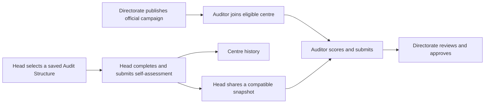

# Independent self-assessments and auditor-only joining

Proposed 15 November 2026. This plan supersedes the join-to-self-assessment
steps in [Plan 3](03_CENTER_HEAD.md) and the older
[role workflow](../ROLE_UI_IMPLEMENTATION_PLANS.md). It is based on the supplied
Head of Centre screenshot and the Kafaa application and migration source.
Hosted state will be checked before implementation.

## 1. Role and workflow

| Role | Official shared audit | Centre self-assessment |
| --- | --- | --- |
| Head of Centre | Read the centre’s authorized official progress and results. Reply to audit feedback and work on corrective actions. | Start, edit, attach proof, and submit a self-assessment for a centre they manage. Share a compatible submitted snapshot with an official campaign when appropriate. |
| Auditor / reviewer | Use **Join audit** from Work or Audits for an eligible centre within the auditor’s grant. Enter independent scores and use the existing team, lead sign-off and submission flow. | Read the submitted snapshot that was shared for the audit and review its proof under the existing official review rules. |
| Directorate | Publish campaigns, assign or manage auditor access through existing controls, monitor progress, review, request revisions and approve. Keep the existing correction workflow. | Review a snapshot shared for a campaign alongside the official evaluation. |
| Super Admin | Manage grants and use the isolated role preview. Normal official joining requires an active auditor grant covering the centre. | Use the isolated Head of Centre preview. An actual self-assessment requires an active Head grant for the centre. |
| Viewer | Retain existing read grants. | No new access. |

**Proposed permission default:** apply “auditor joins” to the first official
audit for a participation, including accounts with Directorate or Super Admin
grants. An account with several roles can join under an active scoped or
roaming auditor grant. An official audit team entry, a preview role, or a
centre ID in the URL carries no authority. The existing privileged correction
operation remains a separate action on an approved audit.

The share path is optional. A Head can complete a self-assessment without an
official campaign. The auditor can proceed when the centre has no shared
snapshot.

## 2. Head of Centre experience

1. **My Centre.** Keep the four cards in the Assessment pair design. Add
   **Start self-assessment**, **Continue draft** where applicable, and
   **Self-assessment history** to the self-assessment area. For several managed
   centres, require a centre selection before starting or loading results.
   Replace campaign join buttons with authorized official status and result
   links. Keep Directorate feedback below the cards.
2. **Start.** Show the selected centre and the current published default
   Audit Structure, for example **Audit Structure v 1.01**, with the scorable
   item count and maximum points where available. Offer **Use latest saved
   structure** and **Choose another saved structure**. Reuse the saved
   structures catalogue and version labels. Show eligible earlier published
   versions; exclude unsaved drafts and any version retired for new work.
   Use the server’s active published default to mean “latest,” since saving
   a version already makes it the default. If there is no valid default,
   require an explicit saved-version selection and explain the condition.
3. **Confirm.** Show the exact version before creating the draft. Persist
   that saved structure’s ID for the life of the assessment, including
   revisions within that assessment. If the default changes while the
   picker is open, keep the version the Head confirmed if it remains eligible.
   Reopen the picker if it no longer qualifies. To use a different structure,
   start a new assessment and keep the existing scored draft available.
4. **Complete.** Reuse the existing self-assessment runner, saved scale
   choices, per-criterion N/A, comments, measurements, and required proof.
   Show the pinned structure version, progress and sync status. A Head
   can resume a draft after an official campaign closes or an auditor submits.
5. **Submit.** Confirm complete scores, finalized required proof and a
   server acknowledgement. Store an immutable submitted snapshot for centre
   history. A revision starts a new draft in the same assessment and structure.
   Copy scores under the existing revision rules and make proof copy explicit.
   A separate assessment begins with an empty checklist. The dashboard card
   shows the most recent submitted snapshot by submission time, with its
   structure version, and opens that exact record. Drafts have a separate
   resume entry and never replace the submitted score.
6. **History.** List drafts and submissions by assessment and revision, with
   dates, structure versions, and any official campaign links. Show missing
   scores separately from genuine zero. Inactive centres keep authorized
   history. The app explains why creating, editing or submitting work is
   unavailable there.

**Proposed defaults:** allow independent assessments over time, with one
current draft per assessment and separate IDs for distinct assessments. Reuse
an existing suitable draft as the primary Continue action. Default new work
to the latest published structure and keep submitted work internal until the
Head explicitly shares it. A required reporting period is outside this flow.
Use the existing English and Arabic terminology and directional layouts.
Stack cards on narrow screens or when larger text requires it.

## 3. Optional comparison and proof sharing

- After a Head submits, offer **Share with official audit** on the snapshot.
  List open eligible campaigns for the same centre and exact template
  ID. An auditor can join later. Show the campaign period, structure version,
  snapshot date, and who will see the shared scores and evidence before
  confirming. Sharing records the link and actor. It does not set joined
  status or create an official audit.
- Permit one selected snapshot per participation. Before the first official
  proof review or first official submission, whichever comes first, the Head
  can withdraw or replace the selection. Keep the changes attributable.
  Once a source review exists, preserve its source and the selection it
  refers to. A linked snapshot is immutable even while the Head continues
  independent work.
- At first official submission, pin the selected valid snapshot ID under the
  existing official campaign lock. A missing selection records no baseline
  and does not block the submission. Preserve the pinned ID, including a null
  baseline, through returned revisions and later corrections. Use the pinned
  snapshot with the approved official result. If a provisional comparison is
  available, label it as provisional and use the currently shared snapshot.
  Keep missing or N/A differences distinct from numerical differences.
- When the structures differ, display **Different Audit Structure versions**
  and the two version labels where the user can read both records. Allow
  viewing them separately. Criterion matching, score gaps and cross-version
  proof reuse require a separate product rule. The dashboard still displays
  the latest approved and latest submitted scores independently.
- Official proof reuse validates the exact shared snapshot, centre, structure
  and criterion, plus finalized, non-removed evidence and object metadata.
  Existing review and sign-off requirements still apply. Sharing never
  imports scores, awards a badge, creates an official corrective action or
  counts towards official campaign progress.

Treat historical links separately during backfill. Preserve a legacy audit’s
pinned baseline and any proof sources already recorded, including distinct
source snapshots referenced by different proof reviews. Preserve authorized
historical reads from those records. Leave previously unselected snapshots
unshared in the new flow.

## 4. Backend implementation

The current source requires `center_self_audits.participation_id` and derives
the template, access and edit lock from the official campaign. The join RPC
and the direct official-audit insert policy also accept centre managers.
The official proof candidate and comparison paths assume the same
participation. These have to change together.

| Area | Proposed contract |
| --- | --- |
| Self-assessment identity | Add a centre-owned assessment record with a stable UUID and an immutable saved `template_id`. Backfill a record per legacy self history and associate existing self headers. Use that identity to scope version numbers and enforce one draft per assessment. Keep parent references and the exact original template IDs. Retain the old participation link as legacy provenance. Independent work leaves it empty. |
| Draft and submission | Add an explicit centre/structure start RPC and a same-assessment revision operation. The server checks current role, centre activity and structure eligibility, derives actor/time, and validates the request ID and full immutable request identity on retry. Keep existing self response and proof IDs, expected revisions and mutation IDs. Separate draft and submission locks from the official session deadline. Keep snapshot and proof validation atomic and preserve the original scoring calculation. |
| Official joining | Use one active auditor-with-centre predicate for the join RPC, direct initial audit insert guard and RLS. Check it before returning an existing audit ID. Preserve eligibility, active centre, current deadline, campaign-template binding and one initial audit under the existing session lock. Keep Directorate review/revision/correction permissions independently scoped. Verify that manager functions which update allowed centre profile data, reply or submit CAPA still work. |
| Share and baseline | Add a dedicated participation-to-submitted-snapshot selection with actor, time and change history. Enforce centre and template equality and validate eligibility before any share, including direct requests. Serialize share changes against official submission and source review using the existing official campaign lock. Use a consistent lock order for any operation touching both records. Legacy baseline and reviewed source IDs remain resolvable. |
| Access and evidence | RLS covers centre ownership, current role and explicit shared-snapshot read access. Keep writes limited to authorized Head operations, reject anonymous access, restrict client grants and derive ownership from the session. Include the same authorization in summary views, functions, storage uploads, downloads and proof review candidate queries. Extend the private proof bucket path validation for new identities while preserving old object keys. Keep historical access needed to read pinned baselines and recorded proof decisions. |
| Queries | Load latest submitted self-assessment and history by centre, independently from campaign lists. Use a paginated query and index the centre/assessment/time lookups and membership/selection foreign keys. Use invoker views or RPCs and preserve the existing score calculation, evidence rules, N/A rules and approved official ranking. |

Review the data and file policies together. Use Supabase’s
[row security guidance](https://supabase.com/docs/guides/database/postgres/row-level-security)
and [storage access guidance](https://supabase.com/docs/guides/storage/security/access-control)
for the authorization and evidence checks.

Create a new server capability for this workflow. An updated client with an
older server can show a localized unavailable or read-only state and keep
existing local work accessible under its current access rules. It should
never take a Head back through the campaign join flow as a fallback.

Keep the final baseline and historical proof checks compatible with both
legacy and newly shared records before enabling independent creation. Rehearse
against a copy of the installed schema and its migration history before
changing the hosted database.

## 5. App, offline work and compatibility

- Update permissions and all launch surfaces. Check My Centre, Audits,
  centre-detail links, the tester journey, deep links, direct calls and
  queued replay. Organize the Head’s Audits tab around **Official audits**
  and **Self-assessments**. Keep official join/status controls in the
  auditor’s workspace and allow the Head to inspect authorized official
  records and feedback. Give the self-assessment runner and history routes
  stable self-assessment IDs. Keep legacy links resolvable after validating
  the old participation and centre, and keep existing comparison links.
- Confirm creation online against the saved-structure catalogue for the
  first release. Existing drafts remain editable offline with their pinned
  checklist, comments and owned proof files. Share, submit and authorization
  decisions require server acknowledgement. If connected creation loses
  its acknowledgement, resume the same draft by stable request ID; avoid
  duplicate records and preserve any dependent local work.
- Keep project/user cache partitions and native/web proof retention. During
  upgrade, resolve pending legacy self creation, answers and proof uploads
  against the new owner identity or existing original IDs. Preserve queue
  order, dependency IDs, expected revisions and upload reservations.
  A denied or ambiguous item remains available for reconciliation. If a
  legacy Head join is still queued, keep a recoverable record and explain
  that the auditor must join. Never auto-convert a legacy join into a
  self-assessment or silently drop dependent work.
- Display failures distinctly from empty data. Resume an acknowledged draft
  immediately after navigation, refresh the self card after submission, and
  preserve history across relaunch, account switch and version upgrades.

Implementation touchpoints include `features/center_head` for the dashboard,
`features/self_audit` and the self repositories for start and resume,
`assessment_sessions_screen.dart` and `session.dart` for join entry points,
`app_router.dart` for route context, `gap_analysis_repository.dart` and
`load_criterion_proof` for comparison and evidence, and `sync_service.dart`
for queue compatibility.

## 6. Migration, verification and release

| Stage | Work and exit criteria |
| --- | --- |
| 1. Inventory and rehearse | Verify the exact Kafaa endpoint and project URL through the dedicated scoped connection. Inspect deployed functions, grants, views, policies, logs, advisors and migration history. Inventory centre self histories, linked baselines, review records and proof metadata. Use disposable fixtures for legacy queues and migration rehearsal. |
| 2. Add and backfill | Add the centre-owned identity, secure reads, and independent start/submit paths. Verify row counts, exact template IDs, points, parent links, proof object keys and review references before and after. Preserve official audits already opened under the old rule, including any opened by a Head. The assigned auditor can continue the existing record. Keep historical official and self results unchanged. |
| 3. Switch roles and clients | Exercise the new Flutter flows and update the isolated owner preview with a Head scenario without a campaign, another with a compatible snapshot to share, and an auditor joining for the same centre. Exercise live role changes only in isolated fixtures. Update the full schema installer and demo seed to join under an auditor fixture and approve under a reviewer. Enable the role restriction on the server when the updated client is ready. The backend must reject old client and stale queued Head joins at cutover. Keep old self RPCs only where they can safely resume existing authorized work. |
| 4. Verify and publish | Run Flutter analysis and tests, installer and SQL role suites, hosted rollback-only smoke tests after deployment approval as applicable, the configured Android launch and private Safari preview with authorized role accounts. Update the Admin Guide, role plans, project review and memory. Use a rehearsal to verify how to disable the new UI or revert compatibility code without losing new drafts or restoring Head join permissions. |

Required acceptance evidence:

- A Head starts a self-assessment with zero official campaigns and zero
  participation rows. Starting, scoring, saving proof and submitting leave
  official audit counts, ranks, NCRs and badges intact.
- A Head chooses the latest published default or an older saved version,
  then publishes another structure as admin in the fixture. The saved
  draft still reads the original checklist, options and maximum. Tampered
  template IDs, draft templates, mixed-structure criteria and cross-centre
  access are rejected.
- A Head cannot join via the app, a direct URL, the old RPC, direct insert
  or legacy outbox replay. Authorized scoped and roaming auditors join;
  out-of-scope, revoked and inactive staff are denied. Duplicate or
  concurrent joins resume the same official assessment. Directorate can
  review, request revisions, approve and create a legitimate correction.
- Same-centre/same-structure sharing works before the official cut-off and
  pins the exact snapshot. Cross-centre, different-structure and draft
  shares are rejected. Test share/replacement versus proof review or
  submission races. Verify evidence visibility before and after sharing,
  preserved legacy proof, and no delayed replacement of an approved baseline.
- Verify restart and account isolation, offline draft/attachment recovery,
  lost acknowledgements, concurrent self edits and legacy queued work.
  Confirm that a closed official campaign does not freeze independent
  assessment work. Check English and Arabic phone/tablet layouts, large text,
  card navigation, and both populated and empty dashboard states.

Status: implemented and published on 15 November 2026. See the
[project review](../PROJECT_REVIEW.md#independent-self-assessments-release--15-november-2026)
for verification and the preview link.
